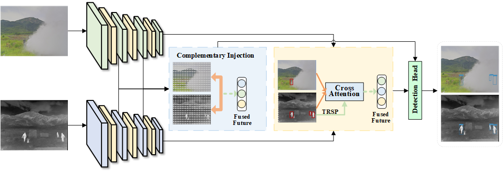
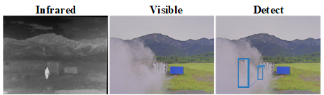

# TRiCF-Net
This repo is the official implementation for TRiCF-Net: A Thermal Radiation Perception
and Coordinate-Guided Cross-Modal Object Detection Network

# Overview
## Framework
<p align="center">
  
</p>

## Visualization
<p align="center">
  
</p>


# Installation
## Clone the repository
git clone [https://github.com/0aaaa0/TRiCF.git](https://github.com/0aaaa0/TRiCF.git)

cd TRiCF
## Create Environment
```shell
conda create -n TRiCF python=3.8
conda activate TRiCF
pip install -r requirements.txt
```

# Datasets

The datasets used in our experiments are available 
through the following links:

| Dataset | Baidu Netdisk |
| :--- | :---: | :---: | :---: |
| FLIR-aligned | [Download](通过网盘分享的文件：FLIR-align-3class.zip
链接: https://pan.baidu.com/s/1eqcYlAguhTYl2bYQP_hxGg?pwd=x5we 提取码: x5we) | 
| VEDAI | [Download](通过网盘分享的文件：FLIR-align-3class.zip等11个文件
链接: https://pan.baidu.com/s/1NLmraKq67UJYCgbHn-9tMg?pwd=newq 提取码: newq) | 
| M3FD | [Download](通过网盘分享的文件：M3FD.zip
链接: https://pan.baidu.com/s/1ddR4h0uVX9WkugQiI8Mphg?pwd=j3g8 提取码: j3g8) | 

Please download and extract the datasets, and place 
them in the `data/multispectral/` directory.

The datasets should be used in accordance with their 
original licenses and terms of use.


# Manual Training & Evaluation
## Training
```shell
python train.py --data data/multispectral/FLIR-align-3class.yaml 
```
## Evaluation
```shell
python test.py --data data/multispectral/FLIR-align-3class.yaml --weights best.pt
```
